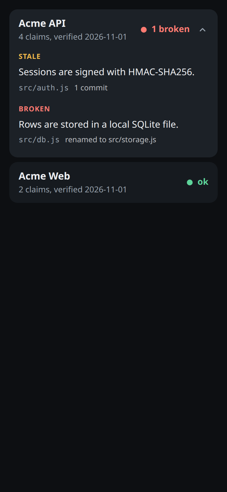
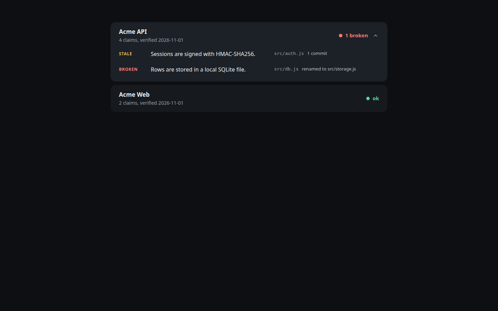

# dossier-scribe

A small CLI that keeps per-project docs true: every factual claim in a doc cites the file it came from, a lock file pins what those files looked like when the doc was last checked, and `check` tells you exactly which claims have drifted.
Docs rot silently, and "this doc is 90 days old" is not actionable, whereas "this one bullet cites a file that changed" is.

Node 22, ES modules, zero dependencies, MIT.

## Try it in 30 seconds

```sh
git clone <this repo> && cd dossier-scribe
node bin/dossier-scribe.mjs demo
```

`demo` builds a throwaway git repo and two dossiers in a temp dir, pins them, commits a change to one cited file and renames another, then runs `check` and `report`:

```
$ dossier-scribe check
acme-api  red  1 broken, 1 stale, 2 ok  verified 0d ago, 2 commits since
  STALE   line 14  Sessions are signed with HMAC-SHA256.  [94de2411e791]
          a cited file changed since the pin
          src/auth.js  changed by 1 commit (+3 -3)
            b0fec6a  Sign sessions with ed25519
  BROKEN  line 20  Rows are stored in a local SQLite file.  [66ecc2431067]
          a cited file was deleted or renamed
          src/db.js  renamed to src/storage.js (100% similar)
            95edccc  Rename db module to storage
acme-web  green  2 ok  verified 0d ago, 0 commits since
```

Install for real use with `npm install -g dossier-scribe` (once published) or run `node bin/dossier-scribe.mjs` from a clone. The binary is `dossier-scribe`, with `dscribe` as a short alias.

## The idea: claim-level drift

Most "keep docs fresh" tooling works per document: re-check it every N commits or every N days. That is coarse, because most commits do not touch what a given bullet claims.

dossier-scribe works per claim. A claim is a list item or paragraph that ends with a source comment:

```markdown
- Sessions are signed with HMAC. <!-- src: lib/auth.mjs -->
```

That bullet is stale exactly when `lib/auth.mjs` changed since the doc was pinned. Nothing else matters to it.

```
 doc.md                         .dossier-lock.json                  repo at HEAD
 ------                         ------------------                  ------------
 - Signs with HMAC.   pin -->   claim 94de2411e791                  lib/auth.mjs
   <!-- src: lib/             -> lib/auth.mjs blob 5b2b6ac   check   blob 31ee7fe   differs
   auth.mjs -->                    commit f8d192d          ------>  => STALE, with the
                                                                    commits and diffstat
 - Pools connections.                                               that changed it
   <!-- src: lib/db.mjs -->  -> lib/db.mjs blob 9c0e1aa            blob 9c0e1aa   same
                                                                    => ok
```

- `pin` records, per claim, a stable id (a hash of the normalised claim text), the cited paths, the git blob hash of each file at HEAD, and the commit. It also sets `last_verified` to today. Pinning is you saying "I checked these claims against these files just now".
- `check` compares the lock with the repo now and labels every claim `ok`, `STALE`, `BROKEN`, `NEW` or `REMOVED`.
- A line range (`lib/auth.mjs:12-40`) pins a hash of just those lines, so edits elsewhere in the file leave the claim `ok`.
- Editing a claim's text gives it a new id: the old id shows as `REMOVED` and the new one as `NEW` until you pin.

## Dossier format

One markdown file per project in the dossiers directory (default `./dossiers`):

```markdown
---
slug: orders-service
name: Orders Service
repo: .
status: active
last_verified: 2026-02-14
tags: [backend, node]
---

Takes orders from the storefront and hands them to fulfilment.

## Features

- Orders are validated against a JSON schema before they are stored. <!-- src: src/validate.js, schemas/order.json -->
- Every route is registered from the routes folder. <!-- src: src/routes/*.js -->
- Payment webhooks are checked with an HMAC signature. <!-- src: src/webhooks.js:20-64 -->

## Architecture

- One process, one SQLite file, no queue. Fulfilment polls. <!-- src: src/server.js, src/db.js -->

## Notes

- Ask the payments team before touching the webhook secret rotation.

<!-- auto:start -->
<!-- auto:end -->
```

**Frontmatter.** `slug` (lowercase, digits, hyphens), `name`, `repo`, `status`, `last_verified` (`YYYY-MM-DD`), optional `tags`. `repo` is a path relative to the configured repos root, or `.` for single-repo use.

The frontmatter parser handles a documented subset, because Node has no YAML parser: `key: value`, `"double"` and `'single'` quoted strings, flat inline lists `[a, "b, c"]`, `true`/`false`, and dates as plain strings. Full-line `#` comments and blank lines are fine. Anything else (nesting, block lists, block scalars, flow maps, anchors, trailing comments, duplicate keys) is rejected with a line-numbered error. It is not a YAML implementation and does not try to be.

**Claims.** A list item or paragraph ending in `<!-- src: ... -->`. The comment takes a comma-separated list of paths relative to the repo:

| Form | Meaning |
| --- | --- |
| `lib/auth.mjs` | the whole file |
| `lib/auth.mjs:12-40` | lines 12 to 40 only (`:12` is one line) |
| `src/routes/*.js` | a glob (`*`, `**`, `?`); adding or removing a match is drift |

A claim with no comment is *uncited*. `lint` reports uncited claims only under sections the config marks as requiring citations (default: Features, Architecture, Data, Deploy). Items elsewhere are free prose.

**Auto block.** Everything between `<!-- auto:start -->` and `<!-- auto:end -->` belongs to the tool. `auto` rewrites it and nothing else, and its contents never count as claims.

**Config.** `dossier-scribe.json` in the working directory (or `--root DIR`):

```json
{
  "dossiers": "dossiers",
  "reposRoot": ".",
  "requireCitations": ["Features", "Architecture", "Data", "Deploy"],
  "uncitedSeverity": "error",
  "collectors": ["package", "python", "go", "rust", "docker", "env", "git", "filetypes"],
  "systemdUnits": { "orders-service": ["deploy/orders.service", "deploy/orders.timer"] },
  "thresholds": { "amberDays": 30, "redDays": 90, "redStale": 3, "diffBytes": 20000, "maxPerDay": 5, "cooldown": "7d" }
}
```

Everything is optional. Add `"systemd"` to `collectors` to enable the unit-file collector.

All git reads are against `HEAD`. Uncommitted edits to a cited file are not drift, and a file you have not committed yet cannot be cited.

## Commands

All commands take `--root DIR`. Exit codes: `0` clean, `1` findings, `2` usage or config error.

### `init`

Writes `dossier-scribe.json` and `dossiers/example.md`, citing a file that exists in your repo. Refuses to overwrite.

### `lint [slug]`

Checks frontmatter, that every cited path exists at HEAD, that line ranges are in bounds, that globs match something, uncited claims under required sections, malformed comments, and duplicate slugs.

```
$ dossier-scribe lint
dossiers/acme-api.md:20: error: src path "src/db.js" does not exist at HEAD
lint: 1 error(s), 0 warning(s)
```

`--json` for machine output. Set `"uncitedSeverity": "warn"` to adopt the tool on existing docs without failing the build.

### `pin [slug] [--all]`

Records the lock entry for every cited claim and sets `last_verified` to today. Writes `<dossiers>/.dossier-lock.json`; commit it. Refuses a dossier that has lint errors, and warns when a cited file has uncommitted changes (it pins the committed version).

```
$ dossier-scribe pin --all
pinned acme-api: 4 claims, last_verified 2026-11-01
pinned acme-web: 2 claims, last_verified 2026-11-01
```

### `check [slug] [--json] [--since X] [--fail-on LIST]`

The command the whole tool exists for (sample output above). Per claim: `ok`, `STALE` (a cited file, or the cited line range, changed: with the commits since the pin and a diffstat), `BROKEN` (cited file deleted or renamed, with `renamed to` when git can follow it), `NEW` (not in the lock), `REMOVED` (in the lock, gone from the doc). Per doc: counts, days since verified, commits since.

`--fail-on stale,broken,uncited` picks what sets exit 1; the default is `stale,broken`, and `new` and `removed` are also accepted. `--since 7d|2026-03-01|<git ref>` hides drift whose changes are all older than the cutoff. `--json` includes a `stats.gitCalls` count: a check makes a handful of git calls per repo, not one per claim, so it stays fast on large repos.

A doc is `red` when anything is broken, `redStale` or more claims are stale, or it is older than `redDays`; `amber` when anything is stale or new, or it is older than `amberDays`; otherwise `green`.

### `queue [--out DIR] [--format md|json|claude-code] [--max N] [--cooldown 7d] [--diff-cap BYTES] [--dispatch-cmd CMD]`

Turns drift into re-verify tasks: one file per drifted doc (stale or broken claims), with the cited files' diffs since the pin trimmed to a size cap, and instructions to re-read the files, fix only the claims that are now wrong, keep sources accurate, and run `dossier-scribe pin <slug>`.

```
$ dossier-scribe queue --out tasks
queued acme-api: 2 drifted claims -> tasks/acme-api.md
queue: 1 task written
```

`queue` never edits dossier prose or the lock. State lives in `<dossiers>/.dossier-state.json`: `--max` caps tasks per day (default 5), and `--cooldown` stops the same doc being queued again for a while (default 7d, `0` disables). Re-pinning a doc resets its cooldown.

### `verify <slug> [--claim ID] [--ok]`

Shows each drifted claim next to the lines it cites (just the range for ranged claims) and the diff since the pin, for quick human checking. `--claim ID --ok` re-pins that one claim and nothing else.

### `auto [slug] [--check]`

Regenerates the auto block from read-only collectors, all reading committed files, no network:

- `package.json`: name, version, script names, dependency counts and names
- `pyproject.toml`, `requirements.txt`, `go.mod`, `Cargo.toml`
- `Dockerfile`: base images and exposed ports
- `.env.example` (and `.sample`, `.template`, `.dist`): variable **names only**, never values
- git totals: commit count, first and last commit date, number of contributors (not names)
- file-type breakdown
- systemd unit `ExecStart` and schedule, for units listed under `systemdUnits`

```
<!-- auto:start -->
- package: acme-api 2.3.0
- npm scripts (2): start, test
- commits: 3
- first commit: 2026-11-01
- last commit: 2026-11-01
- contributors: 1
- file types (6 files): .js 5, .json 1
<!-- auto:end -->
```

The output is deterministic, so running it twice changes nothing. `--check` exits 1 if a block is out of date and writes nothing, for CI. A dossier with no block gets one appended.

### `report [--out index.html | index.md]`

One static page listing every dossier with freshness, worst first. HTML is self-contained (no JavaScript, no external requests), dark by default with a light scheme, built phone-first and widened for desktop. A drifted row expands to list its stale claims and the files that changed.





Markdown output is a table:

```
| Dossier | State | Signal | Claims | Last verified |
| --- | --- | --- | ---: | --- |
| Acme API | red | 1 broken | 4 | 2026-11-01 |
| Acme Web | green | ok | 2 | 2026-11-01 |
```

### `demo [--out DIR]`

The 30-second tour above. Everything happens in a temp dir (or `--out`).

## Using it with AI agents

The tool makes no LLM or network calls itself. It produces the work order; a person or an agent does the rewriting.

`queue --format claude-code` writes a self-contained prompt per drifted doc: what a dossier is, which file to edit, which repo to read, the drifted claims with their diffs, and the exact finish line (`lint`, then `pin`). Paste it into any coding agent:

```sh
dossier-scribe queue --format claude-code --out tasks
cat tasks/orders-service.prompt.md   # paste into your agent
```

To automate that, `--dispatch-cmd` pipes each task to a command on stdin. It is off by default, agent-agnostic, and bounded by `--max` per day and the per-doc cooldown:

```sh
dossier-scribe queue --format claude-code --max 3 \
  --dispatch-cmd 'my-agent --prompt-from-stdin'
```

The command runs through `sh -c` with `DSCRIBE_SLUG` and `DSCRIBE_TASK_FILE` in its environment. A non-zero exit makes `queue` exit 1 and does not start that doc's cooldown. The agent is expected to edit the dossier and run `dossier-scribe pin <slug>` itself; a human review of the resulting diff is a good idea, because the tool can prove a file changed but not that the agent's rewrite is right.

## GitHub Actions: nightly drift issues

[`examples/workflows/dossier-drift.yml`](examples/workflows/dossier-drift.yml) runs `lint` and `auto --check`, runs `check` and `queue`, then uses `gh` to open or update one issue per drifted dossier (using the task file as the issue body) and to close the issue when the dossier is clean again. Copy it to `.github/workflows/`. It needs the lock file committed and `issues: write` permission.

## Pre-commit hook

Save as `.git/hooks/pre-commit` and `chmod +x` it:

```sh
#!/bin/sh
dossier-scribe lint && dossier-scribe auto --check
```

Because every read is against HEAD, a hook sees the previous commit's files: a claim citing a file you are adding in the same commit fails lint until that file is committed. For the stronger `check` gate use a `pre-push` hook instead, where everything is committed:

```sh
#!/bin/sh
dossier-scribe check --fail-on stale,broken
```

## Limits

- It proves that a cited file changed, not that the claim is now wrong. Most drift reports will be a claim that is still true. `verify` and a person (or agent) decide.
- It cannot verify claims about runtime behaviour or external systems: "latency is under 50ms", "the staging database is Postgres 16", "the vendor rate-limits at 100 rps". If a claim has no file that would change when it stops being true, it cannot be cited, and this tool cannot help.
- A claim is only as good as its citations. Cite the narrowest file or line range that would change if the claim stopped being true.
- Reads are against `HEAD`, not the working tree.
- Not a YAML parser, not Windows-tested, no network, no database, no daemon.

## Licence

MIT, see [LICENSE](LICENSE). Copyright (c) 2026 kd-011.

## Contributing

Small, focused changes with tests are welcome. See [CONTRIBUTING.md](CONTRIBUTING.md): DCO sign-off (`git commit -s`), no CLA.
