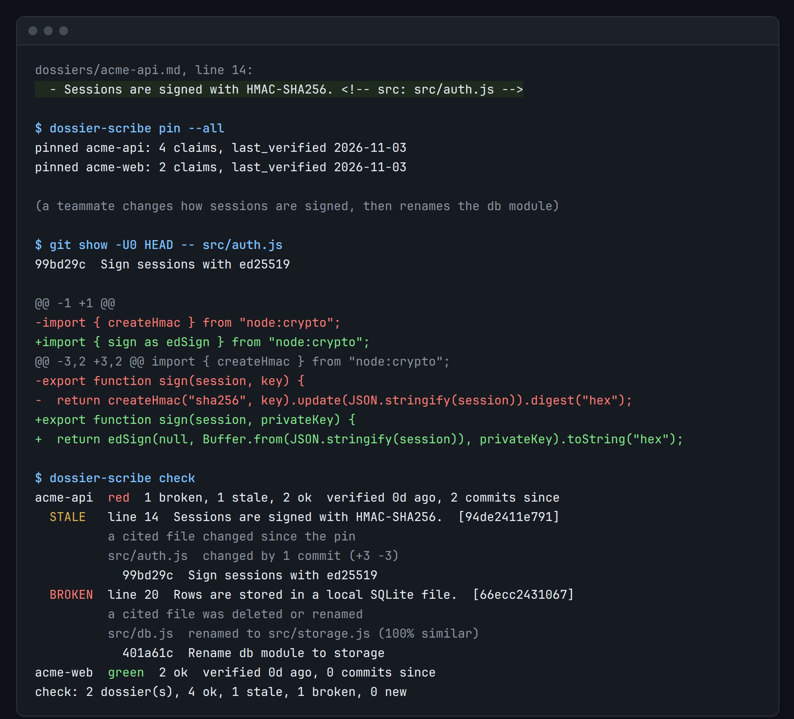

# dossier-scribe

[](https://github.com/kd-011/dossier-scribe/actions/workflows/ci.yml)

Every claim in your project docs cites the file it came from. When that file changes, `dossier-scribe check` names the sentence to recheck.



That is a real run of the demo, rendered by [`scripts/render-assets.mjs`](scripts/render-assets.mjs). Zero dependencies, Node 22, MIT.

## Try it

```sh
npx github:kd-011/dossier-scribe demo
```

It builds a throwaway repo in a temp directory, pins two docs, changes one cited file, renames another and runs `check`. Nothing is written outside the temp directory. It needs Node 22 and git, and the first run takes about 15 seconds because npx clones the repo. It is not on npm yet. Once it is, `npx dossier-scribe demo` will work too.

To keep it: `npm install -g github:kd-011/dossier-scribe`, or clone the repo and run `node bin/dossier-scribe.mjs`. The command is `dossier-scribe`, with `dscribe` as an alias.

## Use it on your repo

```sh
cd your-repo
dossier-scribe init
```

That writes `dossier-scribe.json` and `dossiers/example.md`. Edit the example so it describes your project. A claim is a list item or paragraph that ends with a source comment:

```markdown
- Sessions are signed with HMAC. <!-- src: lib/auth.mjs -->
- Needs Node 20 or newer. <!-- src: package.json#engines.node -->
- Webhooks check a signature. <!-- src: src/webhooks.js:20-64 -->
- Routes load from the routes folder. <!-- src: src/routes/*.js -->
```

Then pin what you just checked, and commit the doc and the lock file:

```sh
dossier-scribe lint && dossier-scribe pin --all
git add dossiers && git commit -m "Pin the docs"
```

From then on, `dossier-scribe check` compares the lock with the repo and exits 1 when a cited file changed. Run it in CI or a pre-push hook ([how](docs/agents-and-ci.md)). When a claim is flagged, `dossier-scribe verify <slug>` shows what it cites next to what changed. Fix the sentence if it is wrong, then `pin` again.

## What check reports

- `ok`: nothing the claim cites has changed.
- `STALE`: a cited file, line range or JSON value changed. You get the commits and a diffstat.
- `MOVED`: the cited lines are unchanged but sit at other line numbers. It does not fail the build.
- `BROKEN`: a cited file was deleted or renamed, or a cited key was removed. A rename comes with the new path.
- `NEW` and `REMOVED`: the claim text was edited since the last pin.

Cite the narrowest thing that would change if the claim stopped being true: a line range, or `package.json#engines.node` instead of all of `package.json`. A whole `package.json` changes with every release and flags every claim that cites it.

## How noisy is it

I pinned docs for p-limit and express a year back and checked them against today. With line ranges and JSON keys, 28 claims produced 7 `STALE`: one was real (p-limit's `pLimit` started taking an options object), six were claims that were still true. Five more were `MOVED`. With whole files cited it was worse: 22 of 28 flagged on 0.1.0, and 19 of those were still true. The tables, the dossiers and a script to reproduce are in [docs/trials.md](docs/trials.md).

Expect to look at a few claims that turn out fine. The tool can show that a cited file changed. It cannot show that the sentence is now wrong.

## When not to use it

- Your docs are about behaviour or outside systems ("p99 is under 50 ms", "staging is Postgres 16"). If no file would change when the claim stops being true, there is nothing to cite.
- You want something to decide whether a claim is still true. This compares hashes against git. Tools that ask a model do that, with the cost and the variance; see [docs/alternatives.md](docs/alternatives.md).
- You need Windows. It is untested there.
- Your docs are not in git. Every read is against `HEAD`, and uncommitted edits are not drift.

## More

- [Reference](docs/reference.md): the dossier format, config and every command (`lint`, `pin`, `check`, `queue`, `verify`, `auto`, `report`).
- [Agents, CI and hooks](docs/agents-and-ci.md): `queue` writes a re-verify task per drifted doc for a person or a coding agent, there is a GitHub Actions example, and a pre-commit hook. The tool makes no model or network calls itself.
- [Trials](docs/trials.md) and [alternatives](docs/alternatives.md).
- [CHANGELOG](CHANGELOG.md), [CONTRIBUTING](CONTRIBUTING.md) (DCO sign-off, no CLA), [SECURITY](SECURITY.md).

MIT, see [LICENSE](LICENSE). Copyright (c) 2026 kd-011.
