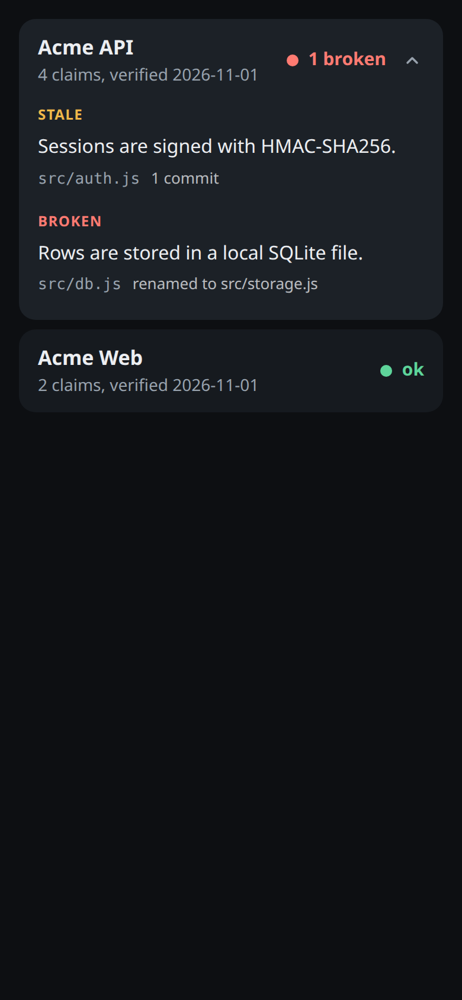
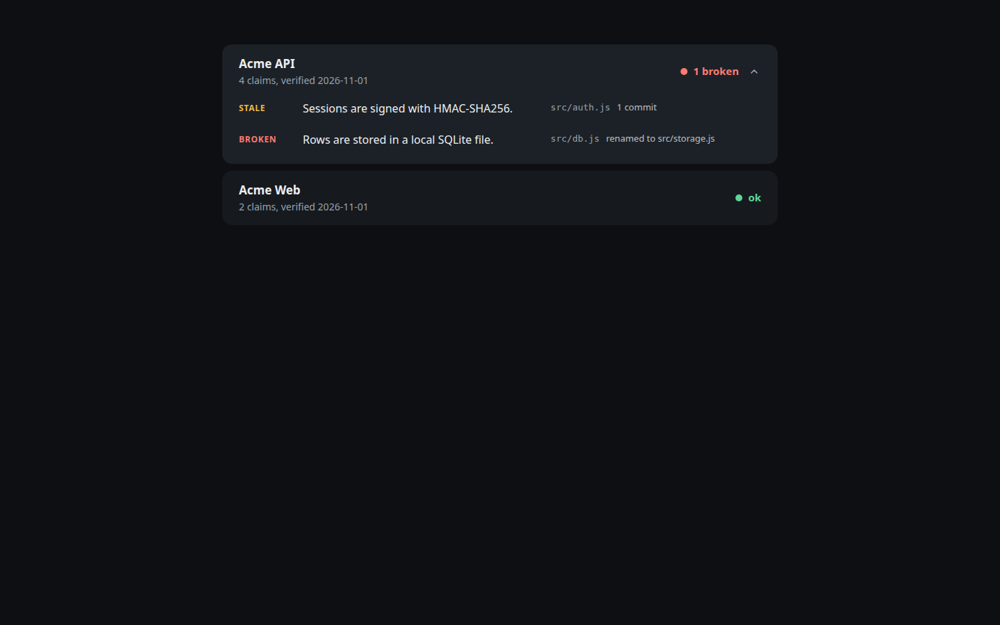

# Reference

The dossier format, the config file and every command. For the short version see the [README](../README.md).

## Dossier format

One markdown file per project in the dossiers directory (default `./dossiers`):

```markdown
---
slug: orders-service
name: Orders Service
repo: .
status: active
last_verified: 2026-02-14
tags: [backend, node]
---

Takes orders from the storefront and hands them to fulfilment.

## Features

- Orders are validated against a JSON schema before they are stored. <!-- src: src/validate.js, schemas/order.json -->
- Every route is registered from the routes folder. <!-- src: src/routes/*.js -->
- Payment webhooks are checked with an HMAC signature. <!-- src: src/webhooks.js:20-64 -->

## Architecture

- One process, one SQLite file, no queue. Fulfilment polls. <!-- src: src/server.js, src/db.js -->

## Notes

- Ask the payments team before touching the webhook secret rotation.

<!-- auto:start -->
<!-- auto:end -->
```

The frontmatter takes `slug` (lowercase, digits, hyphens), `name`, `repo`, `status`, `last_verified` (`YYYY-MM-DD`) and optional `tags`. `repo` is a path relative to the configured repos root, or `.` for single-repo use.

The frontmatter parser handles a documented subset, because Node has no YAML parser: `key: value`, `"double"` and `'single'` quoted strings, flat inline lists `[a, "b, c"]`, `true`/`false`, and dates as plain strings. Full-line `#` comments and blank lines are fine. Anything else (nesting, block lists, block scalars, flow maps, anchors, trailing comments, duplicate keys) is rejected with a line-numbered error.

A claim is a list item or paragraph ending in `<!-- src: ... -->`. The comment takes a comma-separated list of paths relative to the repo:

| Form | Meaning |
| --- | --- |
| `lib/auth.mjs` | the whole file |
| `lib/auth.mjs:12-40` | lines 12 to 40 only (`:12` is one line) |
| `src/routes/*.js` | a glob (`*`, `**`, `?`); adding or removing a match is drift |
| `package.json#engines.node` | one value inside a JSON file, by dotted key |

A key citation pins the value, not the file, so a version bump or a reordered `package.json` leaves the claim `ok`. Keys address objects by name and arrays by index (`files.0`), and the key may contain `:` and `/` (`scripts.lint:fix`, `dependencies.@types/node`) but not `.`. It cannot be combined with a line range or a glob. The cited file must be valid JSON, which `lint` checks.

A claim with no comment is *uncited*. `lint` reports uncited claims only under sections the config marks as requiring citations (default: Features, Architecture, Data, Deploy). Items elsewhere are free prose.

Everything between `<!-- auto:start -->` and `<!-- auto:end -->` belongs to the tool. `auto` rewrites that block and nothing else, and its contents never count as claims.

Config lives in `dossier-scribe.json` in the working directory (or `--root DIR`):

```json
{
  "dossiers": "dossiers",
  "reposRoot": ".",
  "requireCitations": ["Features", "Architecture", "Data", "Deploy"],
  "uncitedSeverity": "error",
  "collectors": ["package", "python", "go", "rust", "docker", "env", "git", "filetypes"],
  "systemdUnits": { "orders-service": ["deploy/orders.service", "deploy/orders.timer"] },
  "thresholds": { "amberDays": 30, "redDays": 90, "redStale": 3, "diffBytes": 20000, "maxPerDay": 5, "cooldown": "7d" }
}
```

Everything is optional. Add `"systemd"` to `collectors` to enable the unit-file collector.

All git reads are against `HEAD`. Uncommitted edits to a cited file are not drift, and a file you have not committed yet cannot be cited.

## Commands

All commands take `--root DIR`. Exit codes: `0` clean, `1` findings, `2` usage or config error.

### `init`

Writes `dossier-scribe.json` and `dossiers/example.md`, citing a file that exists in your repo. Refuses to overwrite. Edit the example so it describes your project, then `lint` and `pin --all`.

### `lint [slug]`

Checks frontmatter, that every cited path exists at HEAD, that line ranges are in bounds, that cited JSON keys exist, that globs match something, uncited claims under required sections, malformed comments, and duplicate slugs.

```
$ dossier-scribe lint
dossiers/acme-api.md:20: error: src path "src/db.js" does not exist at HEAD
lint: 1 error(s), 0 warning(s)
```

`--json` for machine output. Set `"uncitedSeverity": "warn"` to adopt the tool on existing docs without failing the build.

### `pin [slug] [--all]`

Records the lock entry for every cited claim and sets `last_verified` to today. Writes `<dossiers>/.dossier-lock.json`; commit it. Refuses a dossier that has lint errors, and warns when a cited file has uncommitted changes (it pins the committed version).

```
$ dossier-scribe pin --all
pinned acme-api: 4 claims, last_verified 2026-11-01
pinned acme-web: 2 claims, last_verified 2026-11-01
```

### `check [slug] [--json] [--since X] [--fail-on LIST]`

The main command (sample output in the README). Per claim:

- `ok`: nothing the claim cites has changed.
- `STALE`: a cited file, cited line range or cited JSON value changed. The output lists the commits since the pin and a diffstat. A claim that cites a line range or a key says so: the commits listed are for the whole file, because git cannot tell which of them touched the lines. When the same file is behind several stale claims, its commits are listed once and the rest say "same change as above".
- `MOVED`: the cited lines are unchanged but sit at other line numbers, because something was added or removed above them. It does not fail by default. The output gives the new numbers; update them in the doc and `pin` again. `verify` shows the lines at their new position.
- `BROKEN`: a cited file was deleted or renamed (with `renamed to` when git can follow it), or a cited JSON key was removed.
- `NEW`: not in the lock yet.
- `REMOVED`: in the lock, gone from the doc.

Per doc: counts, days since verified, commits since.

`--fail-on stale,broken,uncited` picks what sets exit 1; the default is `stale,broken`, and `new`, `moved` and `removed` are also accepted. `--since 7d|2026-03-01|<git ref>` hides drift whose changes are all older than the cutoff. `--json` includes a `stats.gitCalls` count: a check makes a handful of git calls per repo, not one per claim, so it stays fast on large repos.

A doc is `red` when anything is broken, `redStale` or more claims are stale, or it is older than `redDays`; `amber` when anything is stale, new or moved, or it is older than `amberDays`; otherwise `green`.

### `queue [--out DIR] [--format md|json|claude-code] [--max N] [--cooldown 7d] [--diff-cap BYTES] [--dispatch-cmd CMD]`

Turns drift into re-verify tasks: one file per drifted doc (stale or broken claims), with the cited files' diffs since the pin trimmed to a size cap, and instructions to re-read the files, fix only the claims that are now wrong, keep sources accurate, and run `dossier-scribe pin <slug>`.

```
$ dossier-scribe queue --out tasks
queued acme-api: 2 drifted claims -> tasks/acme-api.md
queue: 1 task written
```

`queue` never edits dossier prose or the lock. State lives in `<dossiers>/.dossier-state.json`: `--max` caps tasks per day (default 5), and `--cooldown` stops the same doc being queued again for a while (default 7d, `0` disables). Re-pinning a doc resets its cooldown.

### `verify <slug> [--claim ID] [--ok]`

Shows each drifted claim next to what it cites and what changed, for quick human checking: the cited lines and only the diff hunks that touch them for a ranged claim, the old and new value for a JSON key, the whole file diff otherwise. `--claim ID --ok` re-pins that one claim and nothing else.

### `auto [slug] [--check]`

Regenerates the auto block from read-only collectors, all reading committed files, no network:

- `package.json`: name, version, script names, dependency counts and names
- `pyproject.toml`, `requirements.txt`, `go.mod`, `Cargo.toml`
- `Dockerfile`: base images and exposed ports
- `.env.example` (and `.sample`, `.template`, `.dist`): variable **names only**, never values
- git totals: commit count, first and last commit date, number of contributors (not names)
- file-type breakdown
- systemd unit `ExecStart` and schedule, for units listed under `systemdUnits`

```
<!-- auto:start -->
- package: acme-api 2.3.0
- npm scripts (2): start, test
- commits: 3
- first commit: 2026-11-01
- last commit: 2026-11-01
- contributors: 1
- file types (6 files): .js 5, .json 1
<!-- auto:end -->
```

The output is deterministic, so running it twice changes nothing. `--check` exits 1 if a block is out of date and writes nothing, for CI. A dossier with no block gets one appended.

### `report [--out index.html | index.md]`

One static page listing every dossier with freshness, worst first. HTML is self-contained (no JavaScript, no external requests), dark by default with a light scheme, built phone-first and widened for desktop. A drifted row expands to list its stale claims and the files that changed.





Markdown output is a table:

```
| Dossier | State | Signal | Claims | Last verified |
| --- | --- | --- | ---: | --- |
| Acme API | red | 1 broken | 4 | 2026-11-01 |
| Acme Web | green | ok | 2 | 2026-11-01 |
```

### `demo [--out DIR]`

Builds a throwaway repo with two dossiers, pins them, changes one cited file and renames another, then runs `check` and `report`. Everything happens in a temp dir (or `--out`). This is the run behind the image in the README.
